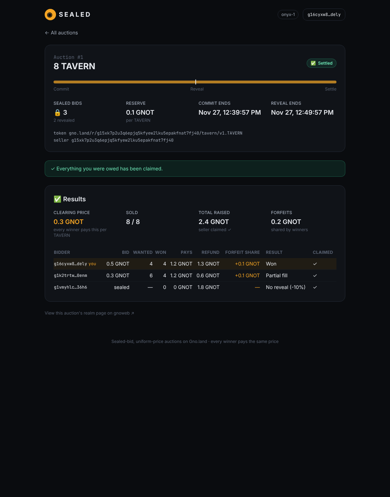
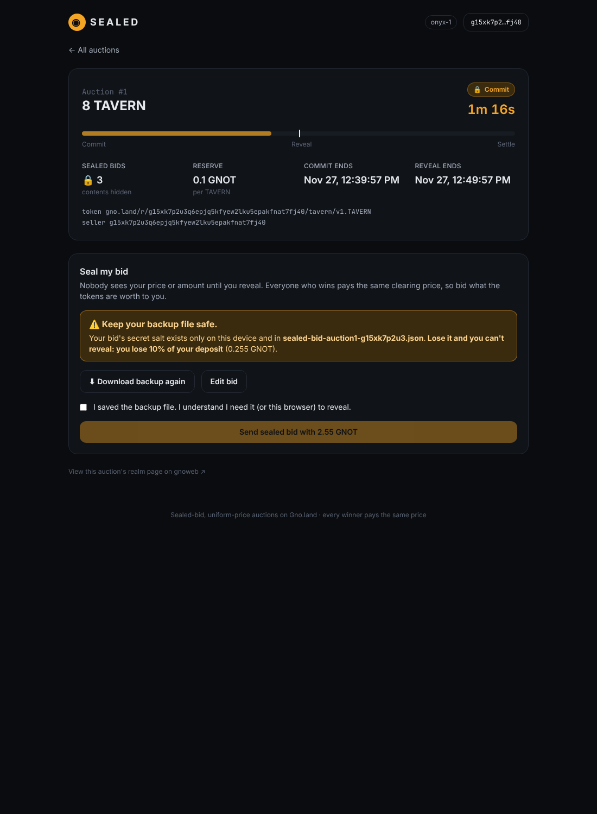

# SEALED: live auction on onyx-1

A real auction on the Onyx testnet against the deployed
`gno.land/r/g15xk7p2u3q6epjq5kfyew2lku5epakfnat7fj40/sealed/v1`, run on
2026-11-27 with `scripts/demo-onyx.sh`. The seller is the deployer key. The
three bidders are fresh testnet-only keys, funded with plain bank sends.

Realm page: https://onyx.testnets.gno.land/r/g15xk7p2u3q6epjq5kfyew2lku5epakfnat7fj40/sealed/v1:auction/1

Setup: 8 TAVERN for sale, reserve 0.1 GNOT, 10 min commit window, 10 min
reveal window (commit ended at unix 1795783197, reveal at unix 1795783797).

| Bidder | Sealed bid | Deposit | Reveals? |
|---|---|---:|---|
| bidder1 | 0.5 GNOT × 4 | 2.5 GNOT (over-deposit hides size) | yes |
| bidder2 | 0.3 GNOT × 6 | 1.8 GNOT | yes |
| bidder3 | 0.4 GNOT × 5 | 2 GNOT | **no** (no-show) |

```
sealed: gno.land/r/g15xk7p2u3q6epjq5kfyew2lku5epakfnat7fj40/sealed/v1 (g19ewgjgpz7duvzr7w9wk356yclhu40gs00wr6wl)
seller: g15xk7p2u3q6epjq5kfyew2lku5epakfnat7fj40
bidder1: g16cyxw8jdpj8wy2gqd0kr0v77x84fpjc673dely
bidder2: g1k2trtw2n2nezjap8hewgcxzs6878h2e0xh0enm
bidder3: g1vmyhlck6znd3al9rqfeghl7ewcuffl0l3r36h6
```

## Result: identical to local

Every number below comes from the chain's own events (`AuctionSettled`,
`Claimed`). Each one equals what the auction rules give for these bids, and
what the local tests and gnodev demo produce.

| Check | Expected | On onyx-1 |
|---|---|---|
| Clearing price (lowest filled bid) | 0.3 GNOT | `clearingPrice=300000` ✅ |
| Tokens sold | 8 of 8 (bidder1 4, bidder2 4 of the 6 wanted) | `sold=8` ✅ |
| Raised (8 × 0.3) | 2.4 GNOT | `raised=2400000` ✅ |
| No-show forfeit (10% of 2 GNOT) | 0.2 GNOT, split 4/8 and 4/8 between the winners | `forfeits=200000`, `burned=0` ✅ |
| bidder1 claim: 2.5 − 4×0.3 + 0.1 | 4 TAVERN + 1.4 GNOT | `tokens=4 ugnot=1400000` ✅ |
| bidder2 claim: 1.8 − 4×0.3 + 0.1 | 4 TAVERN + 0.7 GNOT | `tokens=4 ugnot=700000` ✅ |
| bidder3 (no-show): 2 − 10% | 1.8 GNOT | `tokens=0 ugnot=1800000` ✅ |
| Seller: proceeds only, never forfeits | 2.4 GNOT | `ugnot=2400000` ✅ |
| Escrow after all claims | 0 TAVERN, 0 GNOT | 0 and 0 ✅ |

bidder1 bid 0.5 GNOT but paid the 0.3 GNOT clearing price, like everyone
else. The phase checks also ran for real: reveals were accepted only after
the commit end, and Settle only after the reveal end.

## Every transaction

| # | Step | Height | Tx hash |
|---:|---|---:|---|
| 1 | fund bidder1 | 1450870 | `c2e05112ad669191413f0059457302f199cd603a9331a86c556c59a90228598d` |
| 2 | fund bidder2 | 1450871 | `a7dcc54681e6498a0de43eed247827b43d5884287e7005f97ce8e0ce0216a84f` |
| 3 | fund bidder3 | 1450872 | `56cb5f379e428159f6ca3e30c16eb1ca411be1f66d272c1643c2d1a528ac4dbc` |
| 4 | tavern.Faucet | 1450873 | `7376e51d7dc9b3a546aa1b8cffb8560b8b7315a2ddf85c672fa6486b9f7b25dd` |
| 5 | tavern.Approve | 1450874 | `f86a4549d6f39637c83fc2ef4352cf8bf50313c27eb3fe63c2038e2020f59030` |
| 6 | CreateAuction | 1450875 | `c8bd56a8599720375ca5b5b26a32dabdba39f3929abba826a9d9b61e8c13ad30` |
| 7 | Commit bidder1 | 1450877 | `25ae8c3be44958b52f3fff529190a2715349ad616dcb14ac55a24ea86217a7f9` |
| 8 | Commit bidder2 | 1450878 | `e1c7b5650090ef82e9321a6c36239e0ee2a567ed71c2b54a71f0a5996e5eefa0` |
| 9 | Commit bidder3 | 1450880 | `0f135cd33c54ea93ca080a0c453b6bb1c9fd088d8bf6f26f8dbd679683f13916` |
| 10 | Reveal bidder1 | 1451050 | `613342d4af5fb58f4a5989ec936b580d59cd61f02076246bbad1c84fbd66ca9a` |
| 11 | Reveal bidder2 | 1451051 | `2662fb9f8a0ba5f8d1ab13aaeade12e860a53b500ee3abce54899ebbe452ddbb` |
| 12 | Settle | 1451220 | `305a7ba181757a8a3645622ef92e86e8c1d36f53265c5bf05cef47840acfb7ee` |
| 13 | Claim bidder1 | 1451221 | `fbceb62b9f3afa614e1a65d44a7dae17cecdcb7bd6cb96da580f63ddb52ded30` |
| 14 | Claim bidder2 | 1451222 | `ebc7d674b72edd157d46a017deae7de659ae39abeda08afe8a7e56d1d1745683` |
| 15 | Claim bidder3 | 1451223 | `795eb8d1c3ee6e9b95f37eaff94276a7b532b2df2e99918cb8d231ec82d6efab` |
| 16 | Claim seller | 1451224 | `2a3a89964cf070e0911f79c648f7cc11d3756c16e850467ed4482c7911876725` |

## Pages at each phase

### 1. Created (commit phase, no bids)

```markdown
# Auction #1: 8 TAVERN

[← All auctions](/r/g15xk7p2u3q6epjq5kfyew2lku5epakfnat7fj40/sealed/v1)

**🔒 Commit** · 10m 2s left

- **Token:** `gno.land/r/g15xk7p2u3q6epjq5kfyew2lku5epakfnat7fj40/tavern/v1.TAVERN`
- **Seller:** `g15xk7p2…fj40`
- **Supply:** 8 TAVERN
- **Reserve price:** 0.1 GNOT per TAVERN
- **Commit ends:** 2026-11-27 12:39:57 UTC
- **Reveal ends:** 2026-11-27 12:49:57 UTC

## 🔒 0 sealed bids

Bid contents stay hidden. Only the count is public.

**To bid:** compute `sha256(yourAddress|price|amount|salt)` on your own machine, then call `Commit(1, <hash>)` and send a GNOT deposit of at least price × amount (deposit more to hide your bid size; the extra is refunded).
```

### 2. After 3 sealed commits (home and auction pages)

```markdown
# SEALED

*Sealed-bid token launches. Speed becomes worthless.*

Bots win normal launches by buying first. Here, being first means nothing:

1. **Commit:** post a hash of your bid plus a GNOT deposit. Nobody can see any bid.
2. **Reveal:** open your bid. The realm checks it against your hash.
3. **Settle:** highest bids fill first, and **every winner pays the same clearing price**.

## Auctions

| Auction | Token | Supply | Reserve | Phase | Time left | Sealed bids |
|---|---|---:|---:|---|---|---:|
| [#1](/r/g15xk7p2u3q6epjq5kfyew2lku5epakfnat7fj40/sealed/v1:auction/1) | TAVERN | 8 | 0.1 GNOT | 🔒 Commit | 9m 45s | 3 |

---

**Launch a token:** approve `g19ewgjgpz7duvzr7w9wk356yclhu40gs00wr6wl` on your GRC20 for the sale supply, then call `CreateAuction`.
```

```markdown
# Auction #1: 8 TAVERN

[← All auctions](/r/g15xk7p2u3q6epjq5kfyew2lku5epakfnat7fj40/sealed/v1)

**🔒 Commit** · 9m 45s left

- **Token:** `gno.land/r/g15xk7p2u3q6epjq5kfyew2lku5epakfnat7fj40/tavern/v1.TAVERN`
- **Seller:** `g15xk7p2…fj40`
- **Supply:** 8 TAVERN
- **Reserve price:** 0.1 GNOT per TAVERN
- **Commit ends:** 2026-11-27 12:39:57 UTC
- **Reveal ends:** 2026-11-27 12:49:57 UTC

## 🔒 3 sealed bids

Bid contents stay hidden. Only the count is public.

**To bid:** compute `sha256(yourAddress|price|amount|salt)` on your own machine, then call `Commit(1, <hash>)` and send a GNOT deposit of at least price × amount (deposit more to hide your bid size; the extra is refunded).
```

### 3. Reveal phase (2 of 3 revealed)

```markdown
# Auction #1: 8 TAVERN

[← All auctions](/r/g15xk7p2u3q6epjq5kfyew2lku5epakfnat7fj40/sealed/v1)

**🔓 Reveal** · 9m 45s left

- **Token:** `gno.land/r/g15xk7p2u3q6epjq5kfyew2lku5epakfnat7fj40/tavern/v1.TAVERN`
- **Seller:** `g15xk7p2…fj40`
- **Supply:** 8 TAVERN
- **Reserve price:** 0.1 GNOT per TAVERN
- **Commit ends:** 2026-11-27 12:39:57 UTC
- **Reveal ends:** 2026-11-27 12:49:57 UTC

## 🔓 Reveal phase

**2 of 3** sealed bids revealed.

Call `Reveal(1, price, amount, salt)` before the window closes. A bid that is never revealed loses 10% of its deposit.
```

### 4. Reveal window closed

```markdown
# Auction #1: 8 TAVERN

[← All auctions](/r/g15xk7p2u3q6epjq5kfyew2lku5epakfnat7fj40/sealed/v1)

**⏳ Ready to settle**

- **Token:** `gno.land/r/g15xk7p2u3q6epjq5kfyew2lku5epakfnat7fj40/tavern/v1.TAVERN`
- **Seller:** `g15xk7p2…fj40`
- **Supply:** 8 TAVERN
- **Reserve price:** 0.1 GNOT per TAVERN
- **Commit ends:** 2026-11-27 12:39:57 UTC
- **Reveal ends:** 2026-11-27 12:49:57 UTC

## ⏳ Reveal closed

**2 of 3** sealed bids revealed. Anyone can now call `Settle(1)`.
```

### 5. Settled (bidder3, the no-show, pressed Settle: anyone can)

```markdown
# Auction #1: 8 TAVERN

[← All auctions](/r/g15xk7p2u3q6epjq5kfyew2lku5epakfnat7fj40/sealed/v1)

**✅ Settled**

- **Token:** `gno.land/r/g15xk7p2u3q6epjq5kfyew2lku5epakfnat7fj40/tavern/v1.TAVERN`
- **Seller:** `g15xk7p2…fj40`
- **Supply:** 8 TAVERN
- **Reserve price:** 0.1 GNOT per TAVERN
- **Commit ends:** 2026-11-27 12:39:57 UTC
- **Reveal ends:** 2026-11-27 12:49:57 UTC

## ✅ Results

| Clearing price | Sold | Total raised |
|---:|---:|---:|
| **0.3 GNOT** | 8 / 8 TAVERN | 2.4 GNOT |

Every winner pays **0.3 GNOT per TAVERN**, the lowest accepted bid, however high they bid and whenever they committed.

- **Seller proceeds:** 2.4 GNOT (unclaimed)
- **Unsold, back to seller:** 0 TAVERN
- **Forfeits from no-shows:** 0.2 GNOT, shared by the winners in proportion to tokens won (never the seller)

### Bids

| Bidder | Bid price | Wanted | Won | Pays | Refund | Forfeit share | Result | Claimed |
|---|---:|---:|---:|---:|---:|---:|---|:---:|
| `g16cyxw8…dely` | 0.5 GNOT | 4 | 4 | 1.2 GNOT | 1.3 GNOT | +0.1 GNOT | 🏆 Won | — |
| `g1k2trtw…0enm` | 0.3 GNOT | 6 | 4 | 1.2 GNOT | 0.6 GNOT | +0.1 GNOT | 🌗 Partial fill | — |
| `g1vmyhlc…36h6` | sealed | — | 0 | 0 GNOT | 1.8 GNOT | — | ⚠️ No reveal (-10%) | — |

Winners and refunds: call `Claim(1)`.
```

### 6. After all claims

```markdown
# Auction #1: 8 TAVERN

[← All auctions](/r/g15xk7p2u3q6epjq5kfyew2lku5epakfnat7fj40/sealed/v1)

**✅ Settled**

- **Token:** `gno.land/r/g15xk7p2u3q6epjq5kfyew2lku5epakfnat7fj40/tavern/v1.TAVERN`
- **Seller:** `g15xk7p2…fj40`
- **Supply:** 8 TAVERN
- **Reserve price:** 0.1 GNOT per TAVERN
- **Commit ends:** 2026-11-27 12:39:57 UTC
- **Reveal ends:** 2026-11-27 12:49:57 UTC

## ✅ Results

| Clearing price | Sold | Total raised |
|---:|---:|---:|
| **0.3 GNOT** | 8 / 8 TAVERN | 2.4 GNOT |

Every winner pays **0.3 GNOT per TAVERN**, the lowest accepted bid, however high they bid and whenever they committed.

- **Seller proceeds:** 2.4 GNOT (claimed ✓)
- **Unsold, back to seller:** 0 TAVERN
- **Forfeits from no-shows:** 0.2 GNOT, shared by the winners in proportion to tokens won (never the seller)

### Bids

| Bidder | Bid price | Wanted | Won | Pays | Refund | Forfeit share | Result | Claimed |
|---|---:|---:|---:|---:|---:|---:|---|:---:|
| `g16cyxw8…dely` | 0.5 GNOT | 4 | 4 | 1.2 GNOT | 1.3 GNOT | +0.1 GNOT | 🏆 Won | ✓ |
| `g1k2trtw…0enm` | 0.3 GNOT | 6 | 4 | 1.2 GNOT | 0.6 GNOT | +0.1 GNOT | 🌗 Partial fill | ✓ |
| `g1vmyhlc…36h6` | sealed | — | 0 | 0 GNOT | 1.8 GNOT | — | ⚠️ No reveal (-10%) | ✓ |

Winners and refunds: call `Claim(1)`.
```

```markdown
# SEALED

*Sealed-bid token launches. Speed becomes worthless.*

Bots win normal launches by buying first. Here, being first means nothing:

1. **Commit:** post a hash of your bid plus a GNOT deposit. Nobody can see any bid.
2. **Reveal:** open your bid. The realm checks it against your hash.
3. **Settle:** highest bids fill first, and **every winner pays the same clearing price**.

## Auctions

| Auction | Token | Supply | Reserve | Phase | Time left | Sealed bids |
|---|---|---:|---:|---|---|---:|
| [#1](/r/g15xk7p2u3q6epjq5kfyew2lku5epakfnat7fj40/sealed/v1:auction/1) | TAVERN | 8 | 0.1 GNOT | ✅ Settled | — | 3 |

---

**Launch a token:** approve `g19ewgjgpz7duvzr7w9wk356yclhu40gs00wr6wl` on your GRC20 for the sale supply, then call `CreateAuction`.
```

## Balances after claims

GNOT balances are what is left of each bidder's 5 GNOT after the auction
and gas. TAVERN shows the tokens won.

```
seller: "280020200ugnot" / TAVERN (9992 int64)
bidder1: "3169100ugnot" / TAVERN (4 int64)
bidder2: "3274400ugnot" / TAVERN (4 int64)
bidder3: "4172400ugnot" / TAVERN (0 int64)
sealed escrow TAVERN: (0 int64)
```

## The bidder web page on this auction

`web/` reading auction #1 from onyx-1, connected as bidder1. Every number
comes from the chain:



The "Seal my bid" step: the bid is saved locally and a backup file is
downloaded, and sending stays locked until the bidder confirms the backup.
This screenshot used a stand-in wallet, so no transaction was sent.


